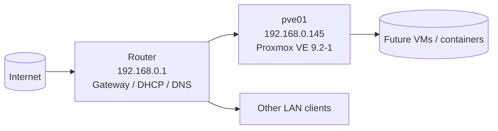

# Homelab

Personal homelab built to practice IT support, systems administration, security, and automation skills. Everything here is documented the way a production environment would be: inventory, network layout, change log, and runbooks.

## Environment

| Item | Detail |
|---|---|
| Hypervisor | Proxmox VE 9.2-1 |
| Node | pve01 (pve01.homelab.lan) |
| Hardware | Dell OptiPlex 5070 Micro, i5-9500T, 16 GB RAM, 256 GB NVMe |
| Management | https://192.168.0.145:8006 |
| Network | 192.168.0.0/24, gateway/DNS 192.168.0.1 |

## Network Diagram

## Repo Contents

- [inventory.md](inventory.md) - hardware, software, and network assets
- [change-log.md](change-log.md) - dated record of every change
- [runbook-proxmox-install.md](runbook-proxmox-install.md) - how pve01 was built

## Roadmap

- [ ] Reserve 192.168.0.145 in router DHCP
- [ ] Switch to no-subscription repos, run first update
- [ ] Create a non-root admin user with 2FA
- [ ] Backup job and storage layout
- [ ] First VM/container, then document as a runbook
